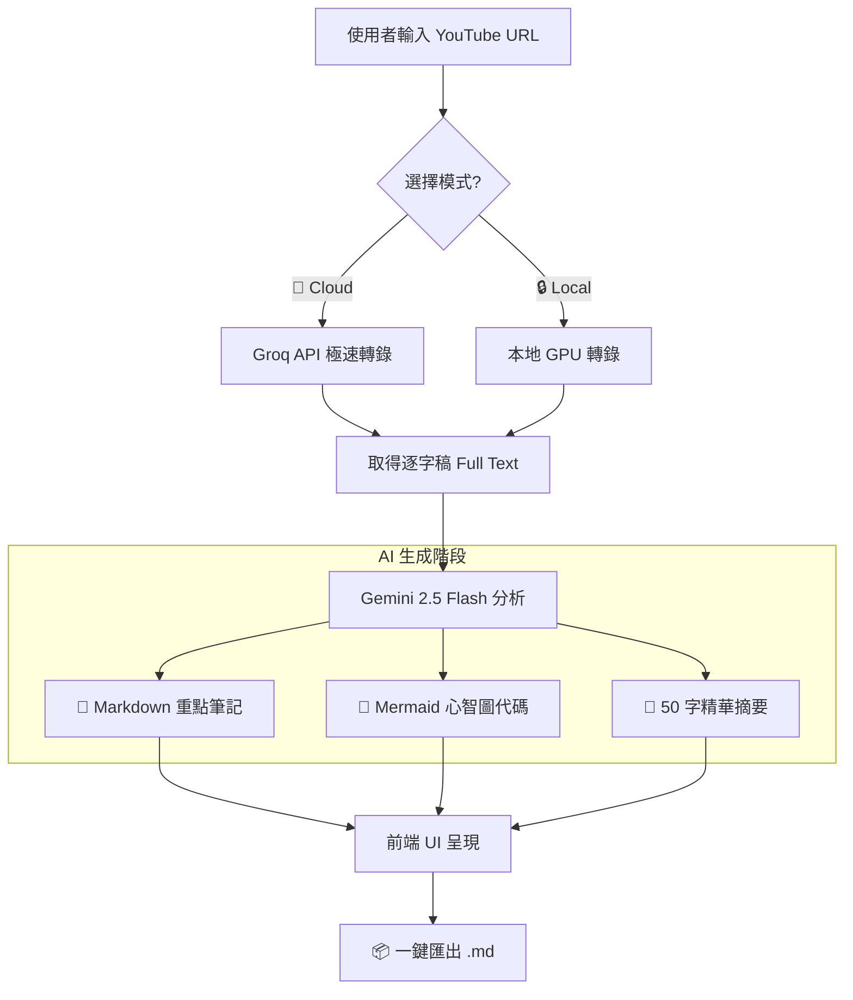
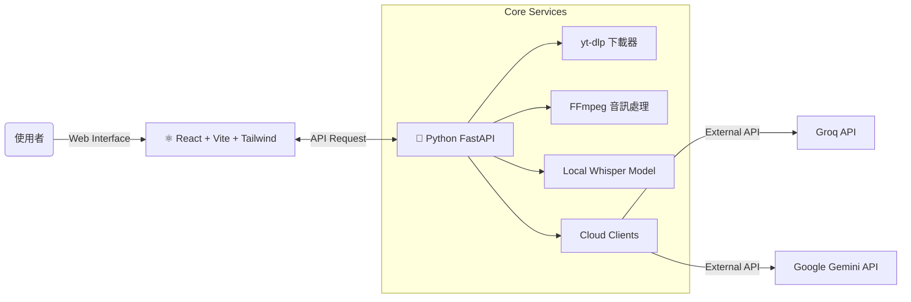

# 🎥 YT Abstract: 你的 AI 影片筆記大師

> **還在花幾個小時手寫影片筆記？讓 AI 幫你「一鍵摘要」，把時間留給真正的思考。**

**YT Abstract** 不只是一個轉錄工具，它是你的第二大腦。結合了 **Local GPU** 的隱私運算與 **Groq/Gemini** 的雲端極速模型，能瞬間將冗長的 YouTube 影片轉化為結構清晰的重點筆記，甚至幫你畫出 **心智圖**。

---

## 📺 實機演示 (Demo)

👀 **親眼見證 AI 如何快速整理影片重點：**

<video src="https://github.com/Zhen-Yu-Liao/yt_abstract/raw/master/demo.mp4" controls="controls" style="max-width: 100%;"></video>

> 💡 如果影片無法播放，請[點此下載](https://github.Yu-Liao/yt_abstract/raw/master/demo.mp4)

---

## ✨ 為什麼選擇 YT Abstract？

### 1. 雙引擎核心 (Dual Engine)

我們懂你的需求，所以提供兩種模式任你切換：

- **🚀 極速模式 (Cloud)**: 趕時間？使用 **Groq API** 搭配 Whisper-large-v3，喝口水的時間就轉錄好了。
- **🛡️ 隱私模式 (Local)**: 影片內容敏感？使用 **NVIDIA 顯卡** 本地運算，資料完全不出這台電腦。

### 2. 次世代 AI 摘要 (Next-Gen Summary)

這不是簡單的抓關鍵字。我們整合了 **Google Gemini 2.5 Flash** 模型，它擁有超長的 Context Window，能讀懂整部電影的脈絡，為你生成像「人類寫的」高品質筆記。

### 3. 視覺化思考 (Visual Thinking)

文字太枯燥？系統會自動分析影片邏輯，生成互動式的 **Mermaid 心智圖**。你可以直接在網頁上縮放、查看，一眼看穿講者的邏輯架構。

---

## 🏗️ 它是如何運作的？ (Workflow)

讓你更了解我們在背後做了什麼魔法：



## 🧩 系統架構 (System Architecture)

專為現代開發者設計的乾淨架構：



---

## 📥 立即使用 (對於一般用戶)

要在您的電腦上跑起來非常簡單 (Windows / Mac / Linux 皆支援)：

### Step 1: 取得程式

前往 [Releases 頁面](../../releases) 下載最新版 (`v1.0.0`) 的壓縮檔。

### Step 2: 申請 API Key (必備！)

為了使用強大的雲端 AI 功能，您需要自己的 API Key (大部分都有免費額度)：

1. **Google Gemini API Key**: [點此申請](https://aistudio.google.com/app/apikey) — 摘要功能必備！
2. **Groq API Key**: [點此申請](https://console.groq.com/keys) — 極速轉錄推薦 (若用 Local 模式可跳過)

### Step 3: 開始執行

#### 🪟 Windows

解壓後雙擊 `yt_abstract.exe` 即可。程式內可以直接輸入剛剛申請的 API Key。

#### 🍎 macOS (重要步驟)

因為我們還是窮開發者，沒繳 Apple 保護費，所以初次執行要做個解鎖：

1. 把 `yt_abstract.app` 拖到「應用程式」資料夾。
2. 開終端機輸入：`xattr -cr /Applications/yt_abstract.app`
3. 完成！以後直接點開就好。

#### 🐧 Linux

```bash
chmod +x yt_abstract
./yt_abstract
```

---

## 🛠️ 開發與貢獻 (對於開發者)

這是一個標準的 **FastAPI + React** 專案，歡迎 fork 回去改成你喜歡的樣子。

### 環境準備

- Python 3.10+
- Node.js 18+
- FFmpeg (記得加到環境變數)

### 快速啟動 (Quick Start)

我們寫好了懶人腳本，一行指令啟動前後端：

```powershell
./start_app.ps1
```

或者手動啟動：

```bash
# Backend
pip install -r backend/requirements.txt
uvicorn backend.main:app --reload

# Frontend
cd frontend
npm install && npm run dev
```

### 📦 如何打包 (Build)

想自己編譯 `.exe` 或 `.app`？

```bash
pip install pyinstaller
python build_exe.py
```

成品會出現在 `dist/` 資料夾中。

---

## 🏛️ 技術架構 (Tech Stack)

| 層級 | 技術 |
|------|------|
| **Frontend** | React (Vite), TypeScript, TailwindCSS, Framer Motion |
| **Backend** | Python, FastAPI |
| **AI Models** | OpenAI Whisper (Local), Groq (Cloud), Google Gemini 2.5 Flash |
| **Tools** | yt-dlp, FFmpeg |

---

> **隱私聲明**: 本軟體採「本地優先」設計。除非您使用 Cloud 模式，否則音訊資料絕不會上傳到第三方伺服器。您的 API Key 也僅儲存於本地 `.env` 檔案中。

*Made with ❤️ by the Open Source Community*
