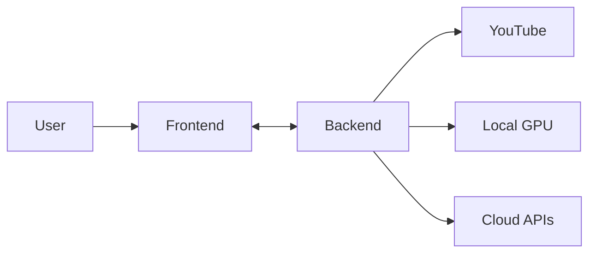

# YT Abstract - 你的極致 YouTube 影片智慧助理

YT Abstract 是一款結合本地強大算力 (Local GPU) 與雲端極速 AI (Cloud API) 的現代化影片摘要工具。它能將冗長的 YouTube 影片轉化為結構清晰的重點筆記、摘要與視覺化心智圖。


## ✨ 核心功能 (Features)

### 1. 雙模轉錄引擎 (Dual Transcription Engine)

- **🚀 Cloud API (推薦)**: 使用 **Groq API** (Whisper-large-v3)，秒級完成長影片轉錄，速度極快。
- **🔒 Local GPU (隱私)**: 使用本地 NVIDIA RTX 顯卡運行 Whisper 模型，完全免費且資料不出機，適合隱私敏感內容。

### 2. 智慧摘要與重點整理 (Smart AI Summary)

- 整合 **Google Gemini 1.5 Flash** 模型，擁有超長 Context Window，無論影片多長都能精準抓取重點。
- 自動生成結構化的 Markdown 筆記。

### 3. [NEW] 視覺化心智圖 (Visual Mind Map)

- 自動分析影片邏輯結構，生成 **Mermaid 心智圖**。
- 直接在網頁上渲染互動式圖表，幫助您快速釐清複雜概念。

### 4. [NEW] 一鍵匯出 (Export Results)

- 點擊右上角的 **下載按鈕**，即可將「逐字稿 + 摘要 + 心智圖代碼」打包成 `.md` 檔案下載。
- 支援 Markdown 閱讀器（如 Obsidian）直接顯示。

### 5. 極致 UI 設計 (Premium UX)

- 採用深色玻璃擬態 (Glassmorphism) 風格。
- 搭載流暢的動畫效果與氛圍光暈，提供最佳閱讀體驗。

---

## 🛠️ 安裝說明 (Installation)

### 前置需求 (Prerequisites)

請確保您的系統已安裝：

1. **Python 3.10+** (後端運行環境)
2. **Node.js 18+** (前端運行環境)
3. **FFmpeg** (必要！用於處理音訊)
   - 請將 FFmpeg 的 `bin` 資料夾加入系統環境變數 (PATH)。
4. **NVIDIA Driver** (僅 Local GPU 模式需要)

### 快速安裝 (Quick Start)

開啟終端機 (Terminal / PowerShell)，執行以下指令：

```powershell
# 1. 安裝後端依賴
pip install -r backend/requirements.txt

# 2. 安裝前端依賴
cd frontend
npm install
cd ..
```

### 設定環境變數 (.env)

在專案根目錄確認 `.env` 檔案（若無則建立），填入您的 API Key：

```ini
# (選填) 用於雲端轉錄 Groq API
OPENAI_API_KEY=gsk_your_groq_key_here

# (必填) 用於生成摘要與心智圖 Gemini API
GEMINI_API_KEY=AIzaSy_your_gemini_key_here
```

> 💡 **小撇步**: 您也可以直接在網頁介面上輸入 Key，系統會優先使用網頁輸入的值。但將 Key 寫入 `.env` 可以省去每次輸入的麻煩。

---

## 🚀 如何啟動 (How to Run)

我們提供了一鍵啟動腳本，這是最簡單的方法：

### 方法一：一鍵啟動 (推薦)

在專案根目錄執行：

```powershell
./start_app.ps1
```

此腳本會自動：

1. 啟動後端伺服器 (Port 8000)
2. 啟動前端開發伺服器
3. **自動開啟預設瀏覽器** 並進入 `http://localhost:5173`

### 方法二：手動啟動

若腳本無法執行，請分別開啟兩個終端機視窗：

**視窗 1 (後端)**:

```powershell
uvicorn backend.main:app --reload --port 8000
```

**視窗 2 (前端)**:

```powershell
cd frontend
npm run dev
```

接著打開瀏覽器前往：[http://localhost:5173](http://localhost:5173)

---

## 📖 使用指南 (User Guide)

1. **貼上連結**: 複製 YouTube 影片網址並貼上。
2. **選擇引擎**:
   - 若您有 **Groq Key**，強烈建議選擇 **Cloud API**，速度最快。
   - 若無，請選擇 **Local GPU** (初次使用需下載模型，會比較慢)。
3. **選擇功能**: 預設勾選 "Transcribe" (轉錄) 與 "Summary" (摘要)。
4. **執行分析**: 點擊 **Run Analysis**。
5. **查看結果**:
   - 處理完成後，右側會顯示兩分頁。
   - **Transcript**: 完整的時間軸逐字稿。
   - **Summary & Mind Map**: 重點摘要筆記與心智圖。
6. **下載**: 點擊右上角的 📥 圖示，將完整報告下載到電腦。

---

## ❓ 常見問題 (FAQ)

**Q: 為什麼進度條一開始會顯示 "0 B"?**
A: 系統正在解析 YouTube 影片資訊，這需要幾秒鐘，稍後就會開始下載並顯示進度。

**Q: 如何獲取 Gemini API Key?**
A: 前往 [Google AI Studio](https://aistudio.google.com/app/apikey) 免費申請。

**Q: 如何獲取 Groq API Key?**
A: 前往 [Groq Console](https://console.groq.com/keys) 免費申請。

---

## 🏗️ 技術架構 (Tech Stack)

- **Frontend**: React (Vite), TypeScript, TailwindCSS, Framer Motion, Mermaid.js
- **Backend**: FastAPI, Python
- **AI Models**: OpenAI Whisper (Local), Groq (Cloud), Google Gemini 1.5 (Summary)
- **Tools**: yt-dlp, FFmpeg

## 🧩 系統架構 (System Architecture)

我們建立了完整的架構文檔與視覺化圖表，請參閱：

- [📂 Architecture Codemap](docs/codemaps/INDEX.md): 包含前後端數據流與 AI 模型互動的 Mermaid 圖表。
- [📏 Project Rules](.agent/rules/project-rules.md): 開發規範與最佳實踐。



---
*Created by Antigravity*
