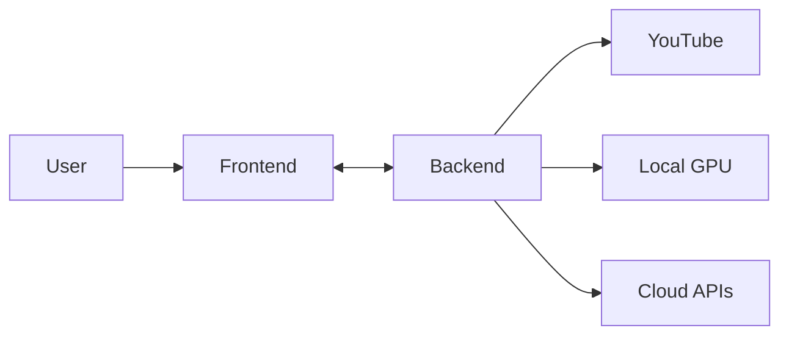

# YT Abstract - 你的極致 YouTube 影片智慧助理

YT Abstract 是一款結合本地強大算力 (Local GPU) 與雲端極速 AI (Cloud API) 的現代化影片摘要工具。它能將冗長的 YouTube 影片轉化為結構清晰的重點筆記、摘要與視覺化心智圖。


## ✨ 核心功能 (Features)

### 1. 雙模轉錄引擎 (Dual Transcription Engine)

- **🚀 Cloud API (推薦)**: 使用 **Groq API** (Whisper-large-v3)，秒級完成長影片轉錄，速度極快。
- **🔒 Local GPU (隱私)**: 使用本地 NVIDIA RTX 顯卡運行 Whisper 模型，完全免費且資料不出機，適合隱私敏感內容。

### 2. 智慧摘要與重點整理 (Smart AI Summary)

- 整合 **Google Gemini 1.5 Flash** 模型，擁有超長 Context Window，無論影片多長都能精準抓取重點。
- 自動生成結構化的 Markdown 筆記。

### 3. [NEW] 視覺化心智圖 (Visual Mind Map)

- 自動分析影片邏輯結構，生成 **Mermaid 心智圖**。
- 直接在網頁上渲染互動式圖表，幫助您快速釐清複雜概念。

### 4. [NEW] 一鍵匯出 (Export Results)

- 點擊右上角的 **下載按鈕**，即可將「逐字稿 + 摘要 + 心智圖代碼」打包成 `.md` 檔案下載。
- 支援 Markdown 閱讀器（如 Obsidian）直接顯示。

### 5. 極致 UI 設計 (Premium UX)

- 採用深色玻璃擬態 (Glassmorphism) 風格。
- 搭載流暢的動畫效果與氛圍光暈，提供最佳閱讀體驗。

---

## 🛠️ 安裝說明 (Installation)

### 前置需求 (Prerequisites)

請確保您的系統已安裝：

1. **Python 3.10+** (後端運行環境)
2. **Node.js 18+** (前端運行環境)
3. **FFmpeg** (必要！用於處理音訊)
   - 請將 FFmpeg 的 `bin` 資料夾加入系統環境變數 (PATH)。
4. **NVIDIA Driver** (僅 Local GPU 模式需要)

### 快速安裝 (Quick Start)

開啟終端機 (Terminal / PowerShell)，執行以下指令：

```powershell
# 1. 安裝後端依賴
pip install -r backend/requirements.txt

# 2. 安裝前端依賴
cd frontend
npm install
cd ..
```

### 設定環境變數 (.env)

在專案根目錄確認 `.env` 檔案（若無則建立），填入您的 API Key：

```ini
# (選填) 用於雲端轉錄 Groq API
OPENAI_API_KEY=gsk_your_groq_key_here

# (必填) 用於生成摘要與心智圖 Gemini API
GEMINI_API_KEY=AIzaSy_your_gemini_key_here
```

> 💡 **小撇步**: 您也可以直接在網頁介面上輸入 Key，系統會優先使用網頁輸入的值。但將 Key 寫入 `.env` 可以省去每次輸入的麻煩。

---

## 📦 如何打包與發布 (Build & Distribution)

本專案已完全自動化。只要您將程式碼推送到 GitHub，**GitHub Actions** 就會自動為您打包出 Windows, Mac, Linux 三個版本的執行檔。

### 自動打包 (推薦)

1. Push code 到 `main` 分支。
2. 前往 GitHub Repo 的 **Actions** 頁面。
3. 等待 `Build Multi-Platform Executables` 跑完 (全綠)。
4. 點擊該次 Run，在下方 **Artifacts** 區塊下載對應平台的壓縮檔。

### 手動打包

若要在本地打包 (僅限目前平台)：

```bash
# 1. 確保已安裝所有依賴
pip install pyinstaller
pip install -r backend/requirements.txt

# 2. 執行打包腳本
python build_exe.py
```

成品位於 `dist/` 資料夾。

---

## 🏃‍♂️ 下載後如何執行 (How to Run Distributables)

給朋友的執行指南：

### Windows 🪟

1. 下載 `yt_abstract_win.zip` 並解壓縮。
2. 進入資料夾，點擊 `yt_abstract.exe` 即可執行。

### macOS 🍎 (必讀！)

由於沒有繳交 Apple Developer 年費 ($99)，初次執行會顯示「應用程式已損毀」。請依序執行以下步驟 (只需做一次)：

1. 下載 `yt_abstract_mac.zip` 並解壓縮。
2. 將 `yt_abstract.app` 拖曳到「應用程式」資料夾 (或任意處)。
3. **開啟終端機 (Terminal)**。
4. 複製並執行以下指令 (修復隔離屬性)：

   ```bash
   xattr -cr /path/to/yt_abstract.app
   # 若您放在應用程式資料夾，路徑通常是 /Applications/yt_abstract.app
   ```

5. 現在可以直接雙擊 App 開啟了！

### Linux 🐧

1. 下載 `yt_abstract_linux.tar.gz` 並解壓縮。
2. 開啟終端機，進入資料夾。
3. 給予執行權限：

   ```bash
   chmod +x yt_abstract
   ```

4. 執行：

   ```bash
   ./yt_abstract
   ```

---

## 🛠️ 開發模式啟動 (Development Mode)

## 🏗️ 技術架構 (Tech Stack)

- **Frontend**: React (Vite), TypeScript, TailwindCSS, Framer Motion, Mermaid.js
- **Backend**: FastAPI, Python
- **AI Models**: OpenAI Whisper (Local), Groq (Cloud), Google Gemini 1.5 (Summary)
- **Tools**: yt-dlp, FFmpeg

## 🧩 系統架構 (System Architecture)

我們建立了完整的架構文檔與視覺化圖表，請參閱：

- [📂 Architecture Codemap](docs/codemaps/INDEX.md): 包含前後端數據流與 AI 模型互動的 Mermaid 圖表。
- [📏 Project Rules](.agent/rules/project-rules.md): 開發規範與最佳實踐。



---
*Created by Antigravity*
